# Text-only vs text + features: detailed comparison

Generated by `ml/analysis/compare_models.py` from the saved test predictions (`out/v2/*/pred_test.parquet`, seed 42). Thresholds are the ones tuned on validation. Figures are in `results/figures/compare_*.png`.

## Mental health vs control (seed 42)

92,738 test tweets from 512 users; positive rate 0.48 per tweet, 0.50 per user. Thresholds tuned on validation: tweet 0.53 / 0.50, user 0.55 / 0.52 (text only / + features).

### Metrics

Brier and ECE (expected calibration error) are lower-is-better; everything else higher.

| Level | Model | accuracy | macro_precision | macro_recall | macro_f1 | pos_precision | pos_recall | pos_f1 | roc_auc | brier | ece |
|---|---|---|---|---|---|---|---|---|---|---|---|
| tweet | Text only | 0.677 | 0.677 | 0.677 | 0.677 | 0.661 | 0.669 | 0.665 | 0.749 | 0.222 | 0.127 |
| tweet | Text + features | 0.683 | 0.683 | 0.683 | 0.683 | 0.661 | 0.694 | 0.677 | 0.757 | 0.208 | 0.081 |
| user | Text only | 0.762 | 0.762 | 0.762 | 0.762 | 0.776 | 0.740 | 0.758 | 0.841 | 0.169 | 0.094 |
| user | Text + features | 0.744 | 0.744 | 0.744 | 0.744 | 0.743 | 0.752 | 0.748 | 0.837 | 0.173 | 0.089 |

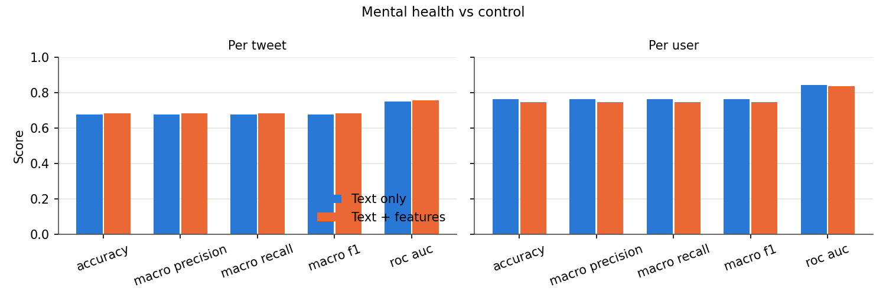

### Confusion matrices

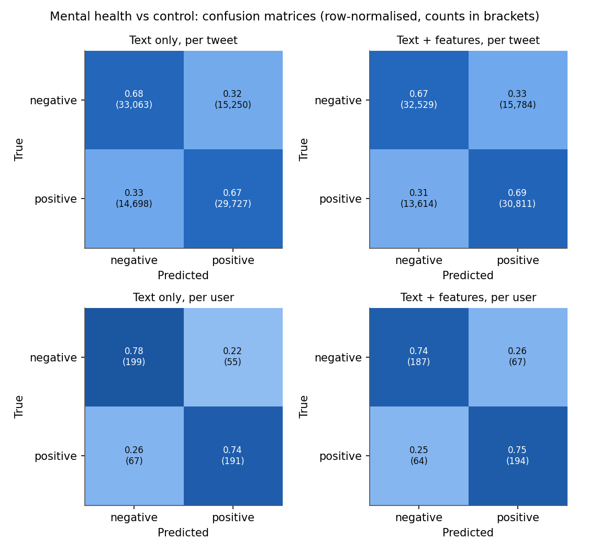

### Prediction confidence and calibration

Confidence = 2·|P(positive) − 0.5| (0 = coin flip, 1 = certain). 'Correct' uses the tuned tweet threshold.

| Model | Mean conf. | Conf. when correct | Conf. when wrong | Tweets with conf. ≥ 0.5 | Accuracy there | Tweets with conf. < 0.2 | Accuracy there |
|---|---|---|---|---|---|---|---|
| Text only | 0.607 | 0.665 | 0.486 | 61.8% | 0.755 | 16.6% | 0.522 |
| Text + features | 0.528 | 0.589 | 0.395 | 51.3% | 0.791 | 22.4% | 0.528 |

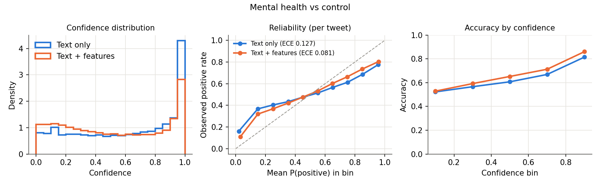

### ROC and precision-recall curves (user level)

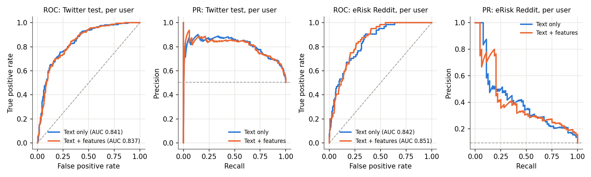

### Where the models disagree

| Level | Disagreements | Text only right | + features right | Correlation of scores |
|---|---|---|---|---|
| tweet | 13,790 (14.9%) | 0.480 | 0.520 | 0.856 |
| user | 37 (7.2%) | 0.622 | 0.378 | 0.967 |

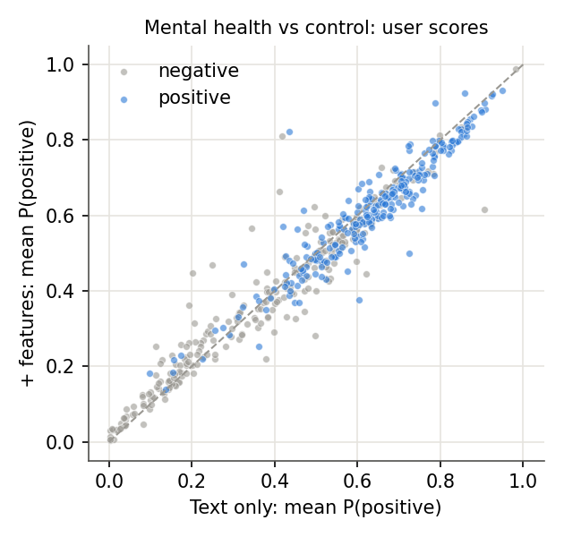

### When do the features help?

Tweets are binned by how unusual their behavioural features are: the mean |scaled feature| over the model's 10 features (each scaled with the train mean/std, so 1 ≈ one standard deviation from typical). ΔAUC = features minus text only, paired bootstrap over users within the bin.

| Feature magnitude | Tweets | Range | Positive rate | Text AUC | + features AUC | ΔAUC [95% CI] | p |
|---|---|---|---|---|---|---|---|
| Q1 (typical) | 23,185 | 0.14–0.48 | 0.471 | 0.754 | 0.757 | +0.004 [-0.007, +0.014] | 0.468 |
| Q2 | 23,184 | 0.48–0.59 | 0.460 | 0.748 | 0.755 | +0.007 [-0.005, +0.017] | 0.228 |
| Q3 | 23,184 | 0.59–0.76 | 0.471 | 0.755 | 0.765 | +0.010 [-0.001, +0.020] | 0.064 |
| Q4 (unusual) | 23,185 | 0.76–2.18 | 0.514 | 0.735 | 0.750 | +0.015 [+0.001, +0.029] | 0.044 |

User-level AUC by how many test tweets the user has (terciles):

| Tweets per user | Users | Range | Text only user AUC | + features user AUC |
|---|---|---|---|---|
| few | 173 | 30–138 | 0.770 | 0.762 |
| medium | 170 | 140–233 | 0.857 | 0.841 |
| many | 169 | 235–306 | 0.888 | 0.896 |

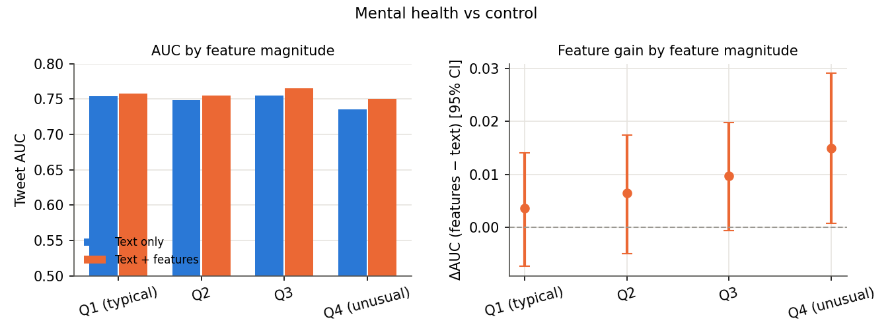

### Screener recall per condition

Share of each group's users flagged as 'mental health' at the tuned user threshold, and the mean user score. The control row is the false-positive rate.

| Group | Users | Text only: flagged (mean score) | + features: flagged (mean score) |
|---|---|---|---|
| control | 254 | 0.22 (score 0.36) | 0.26 (score 0.37) |
| depression | 85 | 0.73 (score 0.62) | 0.72 (score 0.60) |
| anxiety | 87 | 0.78 (score 0.64) | 0.82 (score 0.63) |
| bipolar | 86 | 0.71 (score 0.64) | 0.72 (score 0.62) |

## Depression vs rest (seed 42)

92,738 test tweets from 512 users; positive rate 0.15 per tweet, 0.17 per user. Thresholds tuned on validation: tweet 0.53 / 0.59, user 0.50 / 0.47 (text only / + features).

### Metrics

Brier and ECE (expected calibration error) are lower-is-better; everything else higher.

| Level | Model | accuracy | macro_precision | macro_recall | macro_f1 | pos_precision | pos_recall | pos_f1 | roc_auc | brier | ece |
|---|---|---|---|---|---|---|---|---|---|---|---|
| tweet | Text only | 0.727 | 0.541 | 0.553 | 0.543 | 0.218 | 0.303 | 0.253 | 0.618 | 0.202 | 0.222 |
| tweet | Text + features | 0.765 | 0.542 | 0.541 | 0.542 | 0.225 | 0.218 | 0.221 | 0.620 | 0.183 | 0.181 |
| user | Text only | 0.762 | 0.570 | 0.570 | 0.570 | 0.282 | 0.282 | 0.282 | 0.666 | 0.178 | 0.202 |
| user | Text + features | 0.744 | 0.532 | 0.531 | 0.531 | 0.220 | 0.212 | 0.216 | 0.665 | 0.166 | 0.176 |

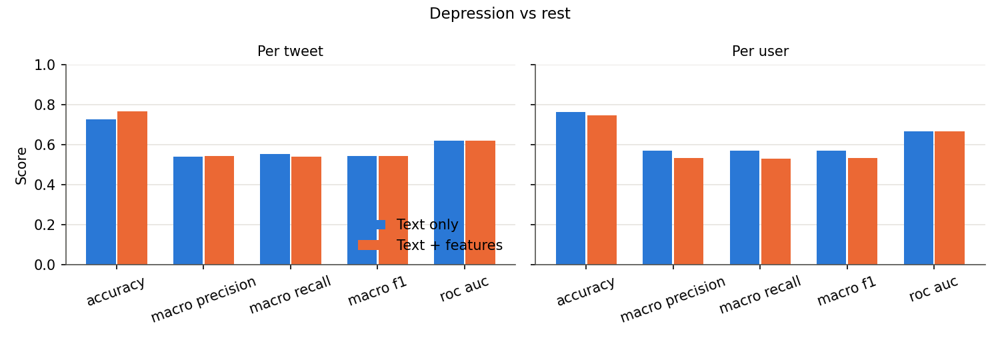

### Confusion matrices

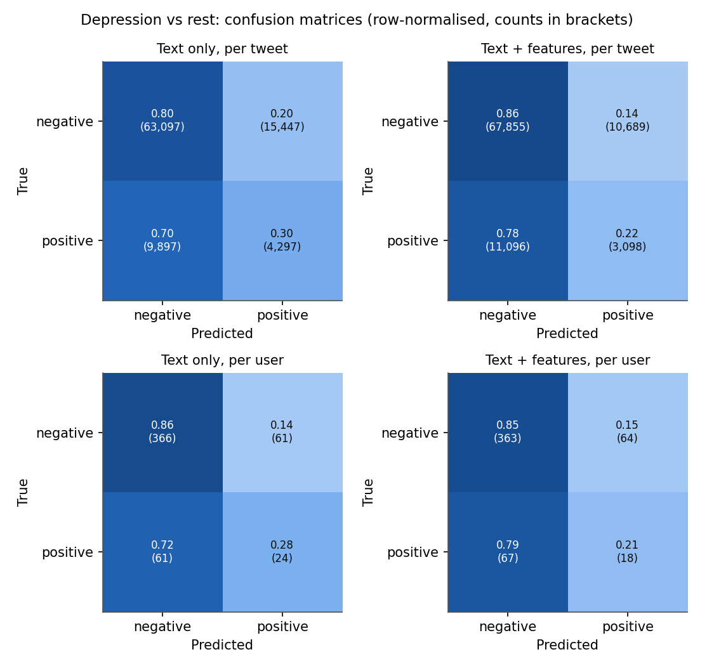

### Prediction confidence and calibration

Confidence = 2·|P(positive) − 0.5| (0 = coin flip, 1 = certain). 'Correct' uses the tuned tweet threshold.

| Model | Mean conf. | Conf. when correct | Conf. when wrong | Tweets with conf. ≥ 0.5 | Accuracy there | Tweets with conf. < 0.2 | Accuracy there |
|---|---|---|---|---|---|---|---|
| Text only | 0.434 | 0.470 | 0.337 | 35.5% | 0.828 | 31.8% | 0.656 |
| Text + features | 0.452 | 0.483 | 0.352 | 47.8% | 0.868 | 25.7% | 0.752 |

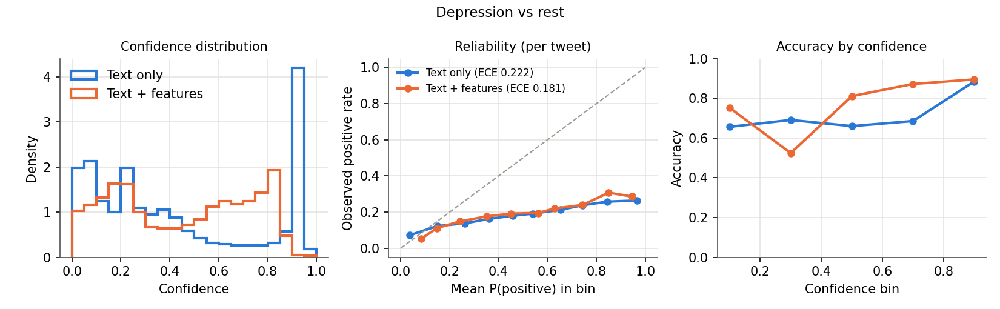

### ROC and precision-recall curves (user level)

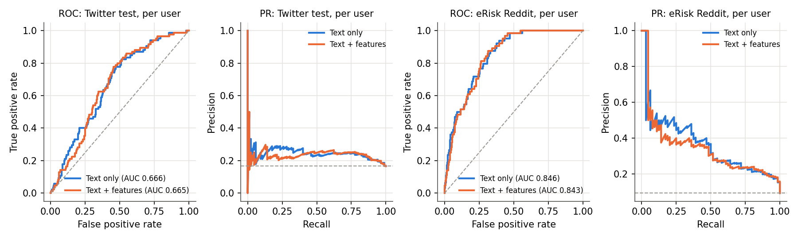

### Where the models disagree

| Level | Disagreements | Text only right | + features right | Correlation of scores |
|---|---|---|---|---|
| tweet | 11,967 (12.9%) | 0.351 | 0.649 | 0.829 |
| user | 27 (5.3%) | 0.667 | 0.333 | 0.961 |

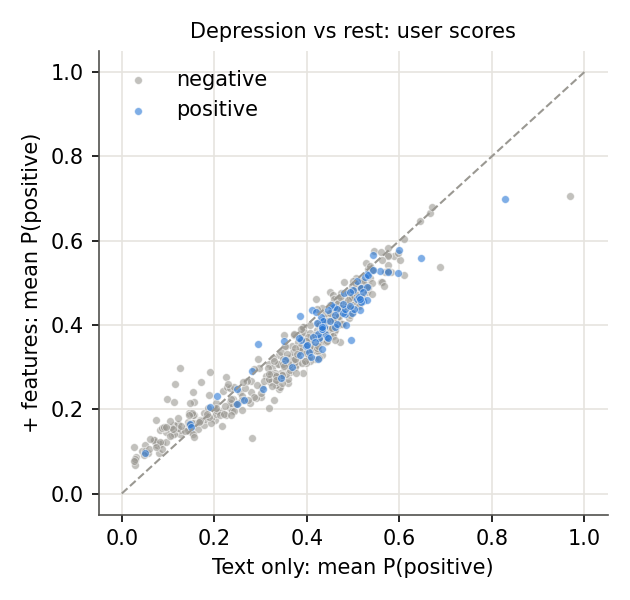

### When do the features help?

Tweets are binned by how unusual their behavioural features are: the mean |scaled feature| over the model's 10 features (each scaled with the train mean/std, so 1 ≈ one standard deviation from typical). ΔAUC = features minus text only, paired bootstrap over users within the bin.

| Feature magnitude | Tweets | Range | Positive rate | Text AUC | + features AUC | ΔAUC [95% CI] | p |
|---|---|---|---|---|---|---|---|
| Q1 (typical) | 23,185 | 0.14–0.48 | 0.157 | 0.608 | 0.606 | -0.002 [-0.015, +0.012] | 0.764 |
| Q2 | 23,184 | 0.48–0.59 | 0.149 | 0.625 | 0.625 | -0.001 [-0.012, +0.011] | 0.972 |
| Q3 | 23,184 | 0.59–0.76 | 0.148 | 0.634 | 0.638 | +0.004 [-0.008, +0.015] | 0.528 |
| Q4 (unusual) | 23,185 | 0.76–2.18 | 0.158 | 0.604 | 0.615 | +0.010 [-0.008, +0.027] | 0.216 |

User-level AUC by how many test tweets the user has (terciles):

| Tweets per user | Users | Range | Text only user AUC | + features user AUC |
|---|---|---|---|---|
| few | 173 | 30–138 | 0.637 | 0.626 |
| medium | 170 | 140–233 | 0.647 | 0.640 |
| many | 169 | 235–306 | 0.708 | 0.711 |

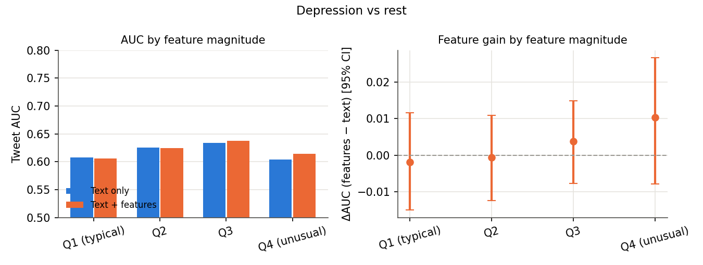

## Anxiety vs rest (seed 42)

92,738 test tweets from 512 users; positive rate 0.16 per tweet, 0.17 per user. Thresholds tuned on validation: tweet 0.59 / 0.57, user 0.51 / 0.55 (text only / + features).

### Metrics

Brier and ECE (expected calibration error) are lower-is-better; everything else higher.

| Level | Model | accuracy | macro_precision | macro_recall | macro_f1 | pos_precision | pos_recall | pos_f1 | roc_auc | brier | ece |
|---|---|---|---|---|---|---|---|---|---|---|---|
| tweet | Text only | 0.761 | 0.565 | 0.568 | 0.566 | 0.270 | 0.283 | 0.276 | 0.656 | 0.185 | 0.191 |
| tweet | Text + features | 0.723 | 0.558 | 0.575 | 0.561 | 0.250 | 0.357 | 0.294 | 0.642 | 0.206 | 0.207 |
| user | Text only | 0.773 | 0.609 | 0.617 | 0.612 | 0.347 | 0.379 | 0.363 | 0.700 | 0.172 | 0.192 |
| user | Text + features | 0.785 | 0.598 | 0.583 | 0.588 | 0.338 | 0.276 | 0.304 | 0.700 | 0.171 | 0.179 |

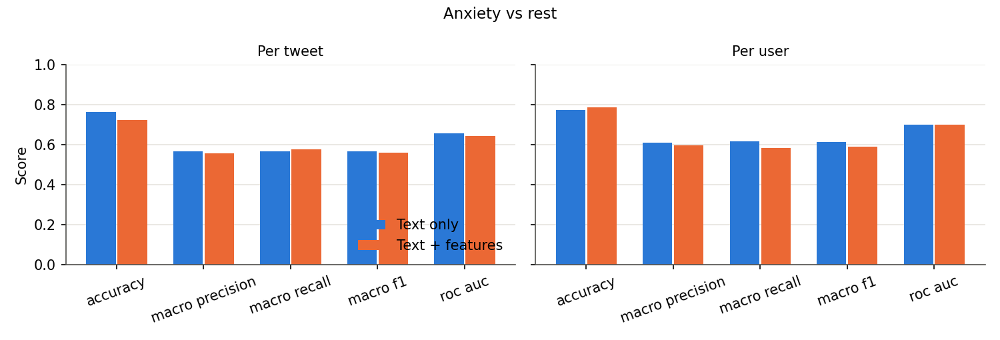

### Confusion matrices

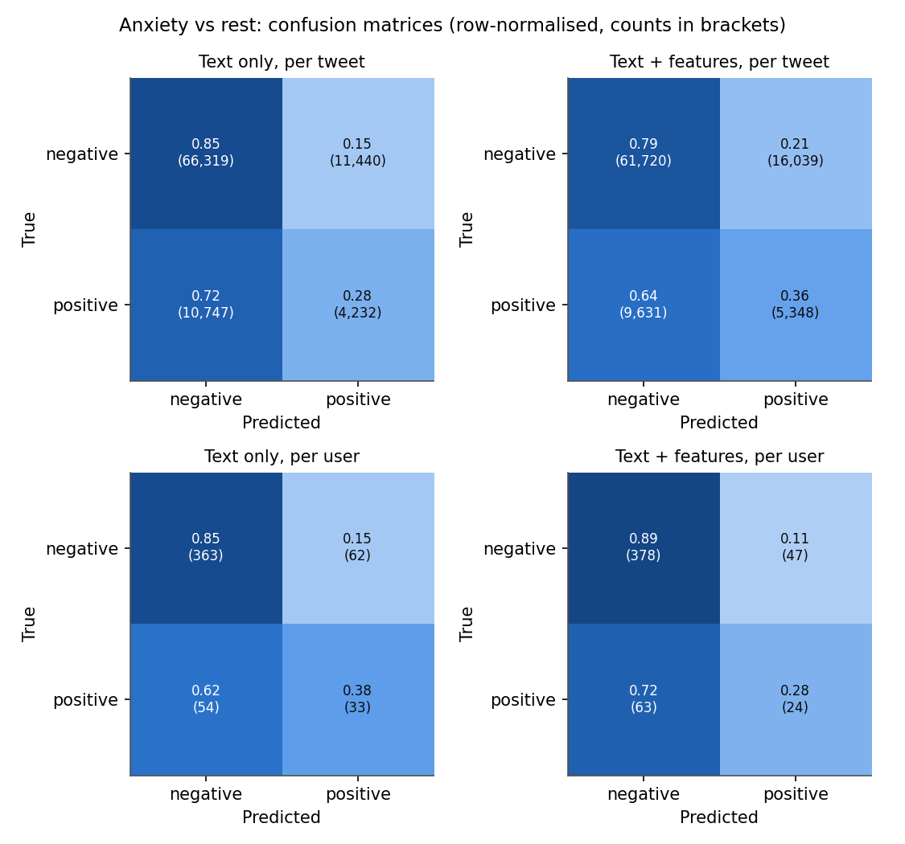

### Prediction confidence and calibration

Confidence = 2·|P(positive) − 0.5| (0 = coin flip, 1 = certain). 'Correct' uses the tuned tweet threshold.

| Model | Mean conf. | Conf. when correct | Conf. when wrong | Tweets with conf. ≥ 0.5 | Accuracy there | Tweets with conf. < 0.2 | Accuracy there |
|---|---|---|---|---|---|---|---|
| Text only | 0.427 | 0.466 | 0.301 | 33.9% | 0.913 | 28.2% | 0.760 |
| Text + features | 0.533 | 0.573 | 0.428 | 50.6% | 0.813 | 25.3% | 0.743 |

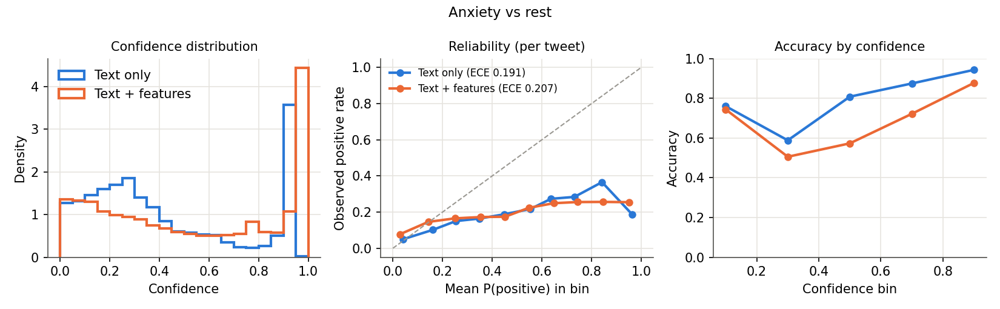

### ROC and precision-recall curves (user level)

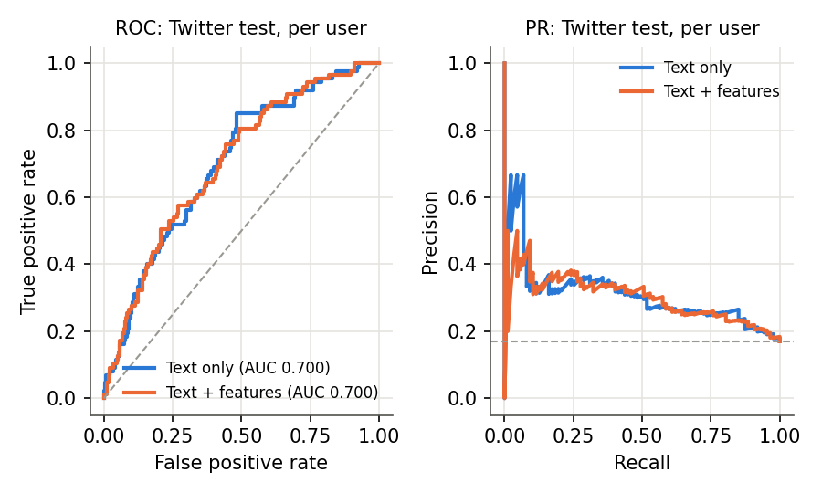

### Where the models disagree

| Level | Disagreements | Text only right | + features right | Correlation of scores |
|---|---|---|---|---|
| tweet | 14,171 (15.3%) | 0.623 | 0.377 | 0.818 |
| user | 44 (8.6%) | 0.432 | 0.568 | 0.962 |

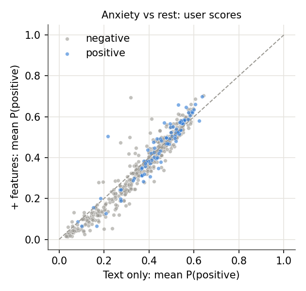

### When do the features help?

Tweets are binned by how unusual their behavioural features are: the mean |scaled feature| over the model's 10 features (each scaled with the train mean/std, so 1 ≈ one standard deviation from typical). ΔAUC = features minus text only, paired bootstrap over users within the bin.

| Feature magnitude | Tweets | Range | Positive rate | Text AUC | + features AUC | ΔAUC [95% CI] | p |
|---|---|---|---|---|---|---|---|
| Q1 (typical) | 23,185 | 0.14–0.48 | 0.157 | 0.680 | 0.664 | -0.016 [-0.029, -0.002] | 0.028 |
| Q2 | 23,184 | 0.48–0.59 | 0.147 | 0.662 | 0.652 | -0.010 [-0.025, +0.009] | 0.240 |
| Q3 | 23,184 | 0.59–0.76 | 0.159 | 0.662 | 0.639 | -0.023 [-0.040, -0.006] | 0.008 |
| Q4 (unusual) | 23,185 | 0.76–2.18 | 0.182 | 0.620 | 0.614 | -0.006 [-0.019, +0.006] | 0.344 |

User-level AUC by how many test tweets the user has (terciles):

| Tweets per user | Users | Range | Text only user AUC | + features user AUC |
|---|---|---|---|---|
| few | 173 | 30–138 | 0.660 | 0.681 |
| medium | 170 | 140–233 | 0.685 | 0.689 |
| many | 169 | 235–306 | 0.751 | 0.730 |

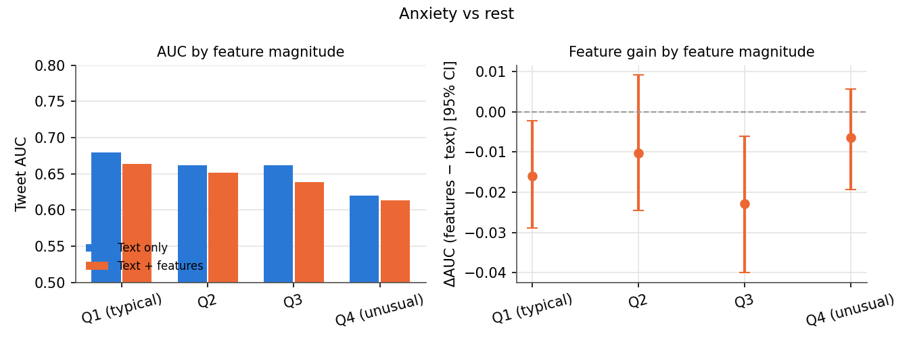

## Bipolar vs rest (seed 42)

92,738 test tweets from 512 users; positive rate 0.16 per tweet, 0.17 per user. Thresholds tuned on validation: tweet 0.64 / 0.68, user 0.58 / 0.58 (text only / + features).

### Metrics

Brier and ECE (expected calibration error) are lower-is-better; everything else higher.

| Level | Model | accuracy | macro_precision | macro_recall | macro_f1 | pos_precision | pos_recall | pos_f1 | roc_auc | brier | ece |
|---|---|---|---|---|---|---|---|---|---|---|---|
| tweet | Text only | 0.720 | 0.564 | 0.586 | 0.568 | 0.262 | 0.386 | 0.312 | 0.654 | 0.245 | 0.266 |
| tweet | Text + features | 0.727 | 0.568 | 0.588 | 0.572 | 0.268 | 0.381 | 0.315 | 0.653 | 0.241 | 0.261 |
| user | Text only | 0.740 | 0.593 | 0.621 | 0.600 | 0.309 | 0.442 | 0.364 | 0.706 | 0.212 | 0.275 |
| user | Text + features | 0.750 | 0.590 | 0.608 | 0.596 | 0.309 | 0.395 | 0.347 | 0.693 | 0.200 | 0.242 |

### Confusion matrices

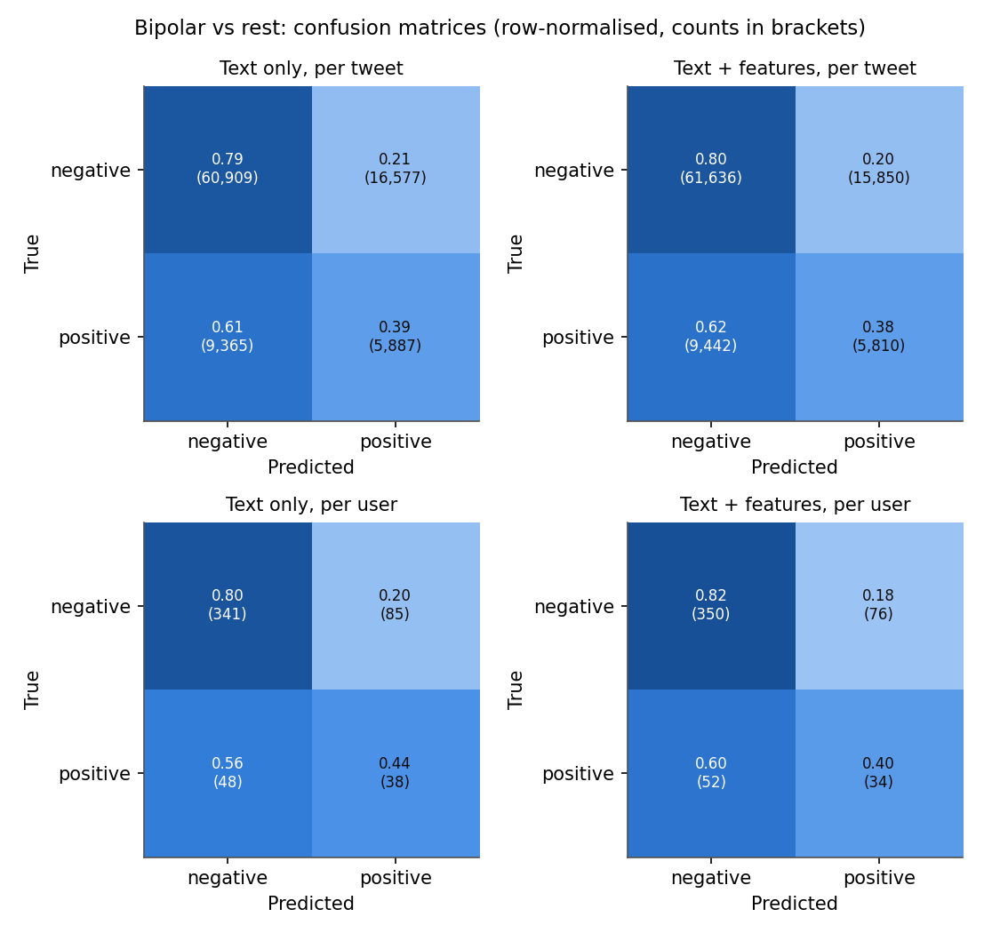

### Prediction confidence and calibration

Confidence = 2·|P(positive) − 0.5| (0 = coin flip, 1 = certain). 'Correct' uses the tuned tweet threshold.

| Model | Mean conf. | Conf. when correct | Conf. when wrong | Tweets with conf. ≥ 0.5 | Accuracy there | Tweets with conf. < 0.2 | Accuracy there |
|---|---|---|---|---|---|---|---|
| Text only | 0.467 | 0.461 | 0.480 | 47.4% | 0.728 | 32.6% | 0.825 |
| Text + features | 0.550 | 0.559 | 0.528 | 55.1% | 0.725 | 21.3% | 0.826 |

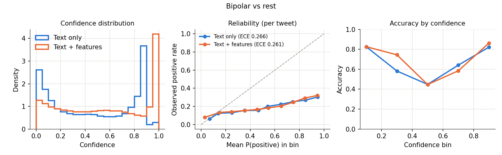

### ROC and precision-recall curves (user level)

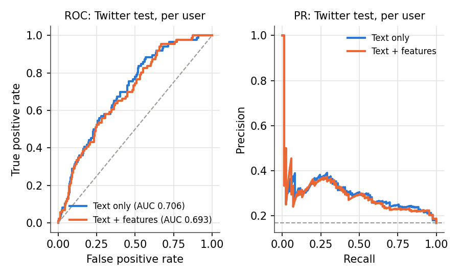

### Where the models disagree

| Level | Disagreements | Text only right | + features right | Correlation of scores |
|---|---|---|---|---|
| tweet | 9,592 (10.3%) | 0.466 | 0.534 | 0.864 |
| user | 25 (4.9%) | 0.400 | 0.600 | 0.972 |

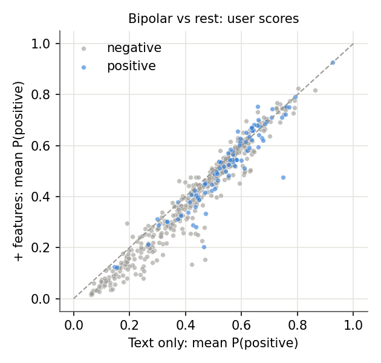

### When do the features help?

Tweets are binned by how unusual their behavioural features are: the mean |scaled feature| over the model's 10 features (each scaled with the train mean/std, so 1 ≈ one standard deviation from typical). ΔAUC = features minus text only, paired bootstrap over users within the bin.

| Feature magnitude | Tweets | Range | Positive rate | Text AUC | + features AUC | ΔAUC [95% CI] | p |
|---|---|---|---|---|---|---|---|
| Q1 (typical) | 23,185 | 0.14–0.48 | 0.157 | 0.647 | 0.643 | -0.005 [-0.019, +0.007] | 0.492 |
| Q2 | 23,184 | 0.48–0.59 | 0.163 | 0.651 | 0.653 | +0.002 [-0.016, +0.015] | 0.852 |
| Q3 | 23,184 | 0.59–0.76 | 0.163 | 0.658 | 0.651 | -0.007 [-0.030, +0.012] | 0.540 |
| Q4 (unusual) | 23,185 | 0.76–2.18 | 0.174 | 0.658 | 0.664 | +0.006 [-0.006, +0.018] | 0.300 |

User-level AUC by how many test tweets the user has (terciles):

| Tweets per user | Users | Range | Text only user AUC | + features user AUC |
|---|---|---|---|---|
| few | 173 | 30–138 | 0.584 | 0.562 |
| medium | 170 | 140–233 | 0.793 | 0.784 |
| many | 169 | 235–306 | 0.731 | 0.730 |

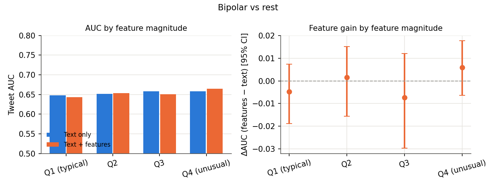

## 4-class model (seed 42)

92,738 test tweets from 512 users. Prediction = argmax; the user prediction is the argmax of the mean probabilities.

| Level | Model | Accuracy | Macro F1 | F1 control | F1 depression | F1 anxiety | F1 bipolar |
|---|---|---|---|---|---|---|---|
| tweet | Text only | 0.431 | 0.349 | 0.642 | 0.236 | 0.239 | 0.279 |
| tweet | Text + features | 0.447 | 0.353 | 0.662 | 0.214 | 0.220 | 0.315 |
| user | Text only | 0.502 | 0.399 | 0.728 | 0.226 | 0.275 | 0.365 |
| user | Text + features | 0.496 | 0.372 | 0.731 | 0.112 | 0.235 | 0.411 |

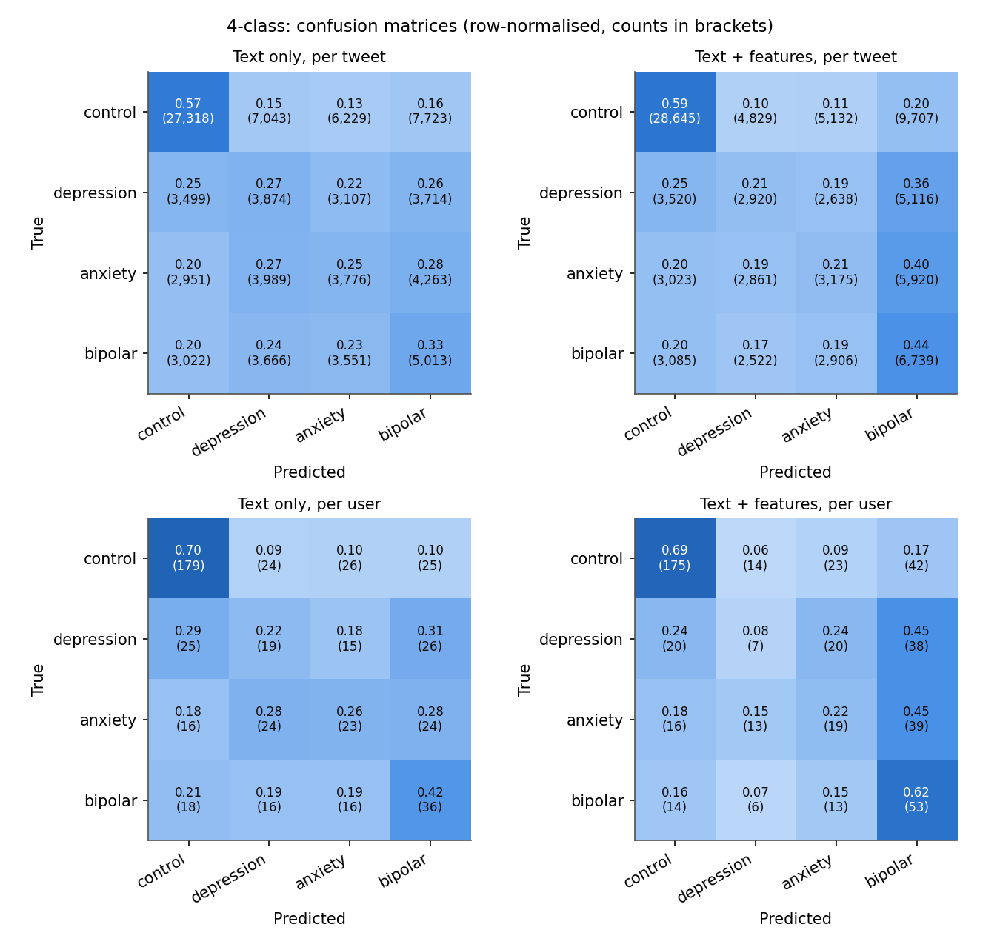

## Summary

| Task | Level | Accuracy text / feat | Macro F1 text / feat | AUC text / feat | ECE text / feat |
|---|---|---|---|---|---|
| Mental health vs control | tweet | 0.677 / 0.683 | 0.677 / 0.683 | 0.749 / 0.757 | 0.127 / 0.081 |
| Mental health vs control | user | 0.762 / 0.744 | 0.762 / 0.744 | 0.841 / 0.837 | 0.094 / 0.089 |
| Depression vs rest | tweet | 0.727 / 0.765 | 0.543 / 0.542 | 0.618 / 0.620 | 0.222 / 0.181 |
| Depression vs rest | user | 0.762 / 0.744 | 0.570 / 0.531 | 0.666 / 0.665 | 0.202 / 0.176 |
| Anxiety vs rest | tweet | 0.761 / 0.723 | 0.566 / 0.561 | 0.656 / 0.642 | 0.191 / 0.207 |
| Anxiety vs rest | user | 0.773 / 0.785 | 0.612 / 0.588 | 0.700 / 0.700 | 0.192 / 0.179 |
| Bipolar vs rest | tweet | 0.720 / 0.727 | 0.568 / 0.572 | 0.654 / 0.653 | 0.266 / 0.261 |
| Bipolar vs rest | user | 0.740 / 0.750 | 0.600 / 0.596 | 0.706 / 0.693 | 0.275 / 0.242 |

